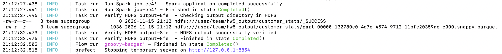
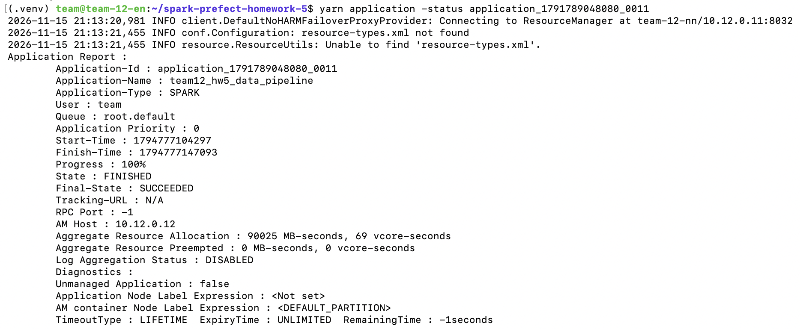
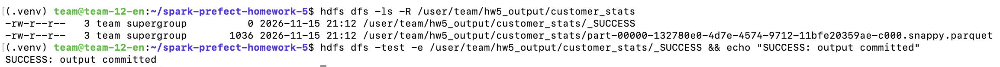
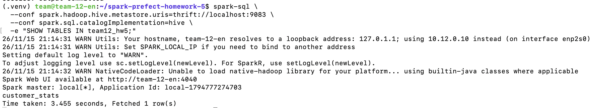
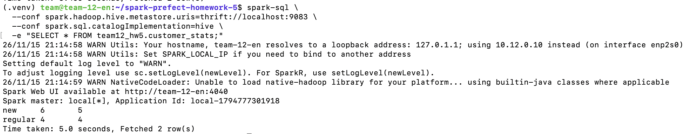

# Домашнее задание №5

## Apache Spark + YARN + HDFS + Prefect

### 1. Описание проекта

В рамках домашнего задания реализован автоматизированный процесс обработки данных (Data Pipeline) с использованием Prefect, Apache Spark, YARN и HDFS.

Pipeline выполняет следующие этапы:

1. Запуск Spark-приложения на кластере YARN.
2. Подключение к HDFS.
3. Чтение исходных данных клиентов из CSV-файла.
4. Очистка и преобразование данных.
5. Агрегация данных.
6. Сохранение результатов в формате Parquet.
7. Регистрация таблицы в Hive Metastore.
8. Проверка результатов в HDFS.

### 2. Используемые технологии

- Python 3
- Prefect
- Apache Spark
- PySpark
- Apache Hadoop
- HDFS
- YARN
- Hive Metastore

### 3. Структура проекта

- `config.py` — конфигурация Spark и Hadoop.
- `flow.py` — Prefect Flow и управление задачами.
- `spark_job.py` — обработка данных с помощью Spark.
- `run.sh` — скрипт запуска pipeline.
- `requirements.txt` — зависимости Python.
- `README.md` — документация.

### 4. Входные данные

Исходный CSV-файл находится в HDFS:

`hdfs:///user/team/hw4_input/customers.csv`

Используются следующие поля:

- `id` — идентификатор клиента.
- `city` — город.
- `status` — статус клиента.

### 5. Трансформация данных

С помощью PySpark выполняются:

1. Чтение CSV с заголовком и автоматическим определением типов.
2. Проверка обязательных столбцов.
3. Преобразование `id` к типу integer.
4. Удаление лишних пробелов в названиях городов.
5. Приведение названий городов к верхнему регистру.
6. Приведение статусов к нижнему регистру.
7. Исключение записей с отсутствующим статусом.
8. Группировка по статусу.
9. Подсчёт количества клиентов.
10. Подсчёт количества уникальных городов.
 
### 6. Сохранение результатов

Результаты сохраняются в формате Parquet в HDFS:

`hdfs:///user/team/hw5_output/customer_stats`

Также создаётся база данных Hive:

`team12_hw5`

В ней регистрируется таблица:

`team12_hw5.customer_stats`

Для сохранения используется метод `saveAsTable()` с форматом Parquet и указанием пути в HDFS.

После сохранения выполняется SQL-запрос к созданной таблице для проверки результатов.

### 7. Архитектура pipeline

Prefect Flow состоит из двух задач:

- `run_spark_job` — запускает Spark-приложение через `spark-submit` с параметром `--master yarn`.
- `verify_hdfs_output` — проверяет наличие результатов обработки в HDFS.

Spark-приложение выполняется на YARN в режиме client.

### 8. Условия запуска

Перед запуском необходимо:

- Убедиться, что HDFS и YARN запущены.
- Проверить наличие исходного CSV-файла в HDFS.
- Убедиться, что Apache Spark установлен в `/opt/spark`.
- Проверить Hadoop-конфигурацию в `/opt/hadoop/etc/hadoop`.
- Убедиться, что Hive Metastore доступен по адресу `thrift://localhost:9083`.
- Активировать виртуальное окружение с установленным Prefect.
 
### 9. Запуск pipeline

Перейти в директорию проекта:

```bash
cd ~/spark-prefect-homework-5
```

Активировать виртуальное окружение:

```bash
source .venv/bin/activate
```

Запустить pipeline:

```bash
./run.sh
```

Скрипт автоматически запускает Prefect Flow, который последовательно выполняет обработку данных и проверку результатов.

## 10. Результаты выполнения

В данном разделе представлены скриншоты, подтверждающие выполнение основных этапов работы: запуск пайплайна Prefect, выполнение Spark-приложения на YARN, сохранение результатов в HDFS, регистрацию таблицы в Hive Metastore и проверку итоговых данных.

### 10.1. Успешное выполнение Prefect Flow

На скриншоте показано успешное выполнение пайплайна `Team 12 - Homework 5 Data Pipeline`. Обе задачи — `Run Spark job` и `Verify HDFS output` — завершились успешно. Итоговый статус выполнения — `Completed()`.



### 10.2. Выполнение Spark-приложения на YARN

На скриншоте показан статус Spark-приложения `team12_hw5_data_pipeline` в YARN. Приложение завершилось успешно: `State: FINISHED`, `Final-State: SUCCEEDED`.



### 10.3. Проверка выходных данных в HDFS

На скриншоте показано содержимое выходной директории `/user/team/hw5_output/customer_stats`. Результаты сохранены в формате Parquet. Наличие файла `_SUCCESS` подтверждает успешное завершение записи данных в HDFS.



### 10.4. Регистрация таблицы в Hive Metastore

На скриншоте показан результат выполнения SQL-команды `SHOW TABLES IN team12_hw5;`. В базе данных `team12_hw5` зарегистрирована итоговая таблица `customer_stats`.



### 10.5. Проверка итоговых данных

На скриншоте представлен результат SQL-запроса:

```sql
SELECT * FROM team12_hw5.customer_stats;
```

В таблице содержатся агрегированные данные по двум категориям клиентов:

| status | customer_count | unique_cities |
|---|---:|---:|
| new | 6 | 5 |
| regular | 4 | 4 |

Таким образом, проверено наличие итоговых данных и корректность формирования агрегированной таблицы.


 
### 11. Результаты выполнения

Pipeline был успешно выполнен целиком.

Spark-приложение завершилось на YARN с кодом `exitCode 0`.

По результатам обработки получены следующие агрегированные данные:

| Статус | Количество клиентов | Уникальных городов |
|---|---:|---:|
| new | 6 | 5 |
| regular | 4 | 4 |

Результаты сохранены в HDFS в формате Parquet.

Таблица `team12_hw5.customer_stats` создана средствами Spark с поддержкой Hive.

Проверка выходных данных в HDFS завершилась успешно. Prefect Flow завершился в состоянии `Completed()`.

### 12. Итог

В рамках домашнего задания реализован автоматизированный процесс обработки данных с использованием Prefect, Apache Spark, YARN и HDFS.

Выполнены все основные этапы: запуск Spark на YARN, чтение данных из HDFS, трансформация и агрегация, сохранение результатов в Parquet и регистрация таблицы в Hive Metastore.

Процесс автоматизирован и может быть повторно запущен одной командой.
